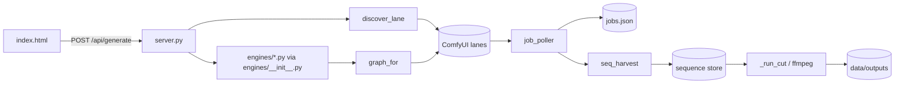
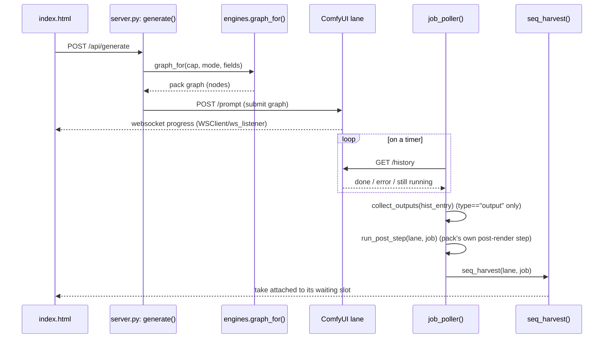
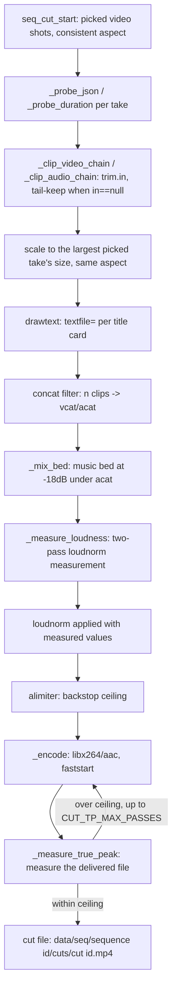

# Architecture

One page. For the pack contract (how to add an engine) see `docs/WRITING-A-PACK.md`.

## Lanes

A **lane** is one render backend the app can send a job to — almost always a ComfyUI
instance (`host`/`port` in `config.json`), reached over its HTTP API and a websocket for
live progress. A second kind of lane, the **process lane**, runs a local program instead
(`runner.py`) — used today for the Blender turntable pack and the Grid check pack
(`engines/producer.py`, beat_this), which run on the CPU and need no ComfyUI at all. The core dispatches to either kind through the same job/poller
machinery; `engines.lane_kind(cap, mode)` is the only place that asks which one a mode needs.

## Discovery

Each lane is polled on a timer (`discover_lane`). The app asks the lane's `/object_info`
for every model **pool** it cares about (checkpoints, UNets, VAEs, CLIPs, LoRAs, ...),
then resolves each engine pack's declared **roles** against what's actually on disk —
matching by rule (`pick_model()`'s case-insensitive `all`/`none`/`any` substring gates on
the filename, plus `prefer` ranking among the survivors) rather than a hardcoded model
list. `abilities(lane)` folds the resolved roles into per-mode booleans through
`engines.abilities()`; `missing_for(lane, mode)` turns an unresolved role into a plain
sentence ("the LTX video model is missing"). A lane's `caps` in `config.json` say what
it's *for*; discovery says what it can *actually* do right now — the UI offers the
intersection.

Ranking is one function, `role_candidates()`: every file that fits a role, best first, each
with the reasons built from the rule's own terms. `pick_model()` is its first entry, and
Setup uses it with the same card test, so discovery, Setup and the page cannot disagree.
Discovery keeps the ranked list and the files a `none` term left out (`role_refused()`, with
the rule's optional `none_why` reason). `config.json` `"models"` pins go on top
(`layer_pins()`): a pin the lane's pool lacks resolves nothing and its mode reads unavailable
with a sentence naming the file; a pin in the pool runs even when it does not fit the rule.
`/api/engines` carries this per mode as `"parts"` (`mode_parts()`), which the page shows
read-only as **What will run**.

## Packs

`engines/` holds one module per model family (Qwen-Image, LTX, MiniMax-H3, the audio
engines, cleanup/upscale tools, pixel art, the 3D pack, the Blender turntable). Each
module exports a single `ENGINE` dict — id, capability, roles, graph builders, form
fields, presets, quality tiers, examples, licence. `engines/__init__.py` is the seam: the
core (`server.py`) never imports a pack directly or names a model; it calls the loader's
functions (`graph_for`, `fields`, `abilities`, ...) and the loader answers from whichever
packs are installed. Adding a model family means adding a file under `engines/`, not
editing the core. A ComfyUI workflow can also be added with no code at all, as a data pack
(a manifest plus an API-format graph in `data/packs/`); see "Data packs" in `docs/WRITING-A-PACK.md`.

## Rooms

`rooms.json` groups modes into task-shaped rooms (Music, Picture, Video, 3D, ...) using
plain task words, never a model or engine name. `engines.rooms()` merges that file with
whatever modes the installed packs actually declare, so a pack with no room entry still
gets a room built from its own label — the page always has somewhere to show a working
engine, and a room with nothing installed for it still shows up, dimmed.

The page no longer shows rooms as a row of tabs (see Tasks). A room is what is left behind
the scenes: the home of a guide, the scope of the guide's conversation and the Cutting Room.
Each task names the room whose guide it uses.

## Tasks

What the page lists is **tasks**: what a person wants to make ("Animate a picture", "Make a
picture bigger"), not modes.

- **`tasks.json`** (repo root, core config, task words only): `id`, `verb`, `short`, `line`,
  `group` (`SOUND`, `PICTURE`, `MOTION` or `OBJECT`), `order`, `room`, and for a task that is
  an app feature rather than a mode, `action` (the music video). It never names a pack's mode
  or a model, so adding a pack stays a file drop.
- **`mode_tasks`** in a pack (a manifest `task`, `way`, `tier`, `final_of`, `pictures` for a data
  pack) says which task each mode belongs to and its short label there. Each mode of a task is
  a **way**. `engines.tasks()` merges the two and `/api/engines` carries the result as the
  top-level `"tasks"` key, beside `"rooms"`; each task has `ways` and a derived `accepts`.
- **Draft and final.** A mode with `tier: "final"` and `final_of: <draft mode>` becomes the
  keeper of that draft's way, not a way of its own. `pictures: n` makes it the keeper for n
  attached pictures; the page picks the one that fits the number of pictures added (the
  nearest lower count, else the lowest). A `final_of` naming a mode outside the task makes
  the mode a plain way and logs a warning. The page draws one Draft / Final switch for the
  way.
- **`accepts`** is never declared. It is the kinds of file (picture, clip, song, model) of the
  primary upload fields of the task's modes. The home screen's drop-a-file uses it.
- **Order** inside a task: built-in packs, then data packs, then pack id, then the pack's
  `graphs` order, so a task opens on the app's own mode.
- **Nothing is hidden.** A mode with no `mode_tasks` entry, or naming a task `tasks.json`
  lacks, becomes a task of its own unless its pack brings that task's words (`mode_task_words`, manifest `task_words`): then the task is created and other modes can join it. A task of its own is `<cap>-<mode>`, ordered after the listed ones; its group is
  its room's group, else the group of the first listed room that holds a mode of the same
  capability, else the capability's word. A pack may bring a task `tasks.json` lacks with
  `mode_task_words`. A task no installed mode fills is listed with `ways: []`. A missing or
  broken `tasks.json` logs a warning and every mode becomes its own task.
- **The page** shows each way's `blurb`, a one-line version of the mode's note, never a data
  pack's own `note`. The home screen, the task bar, the ways list and the Draft / Final switch
  all read this one payload. The home dims a task only when nothing installed fills it or no
  machine in `config.json` declares a capability it needs; a machine that is asleep never
  dims it. The page remembers the way and stage last used per task in the browser. `#task=<id>`
  opens a task; the older `#room=<id>` still works and opens that room's first task.

Writing packs for all of this: `docs/WRITING-A-PACK.md`.

## Guides

A room in `rooms.json` may name a **guide** (`"guide": "film"`): the persona the optional
`helper` speaks as in that room. Each lives in `guides/<id>/`, and `guides.py` loads every
named guide once at startup; a named guide that is missing or broken refuses startup with
one sentence naming the file. `guide.json` carries `id`, `name`, `persona` (the persona
JSON, whose `definition` the panel shows), `projections` (`compact` and `verbose` system
prompts), `knowledge`, `caps` (per projection: `max_tokens` sent to the helper, and
`answer_chars`, past which a reply is cut at a sentence end and flagged), `greeting`, and
`no_brain` (the plain lines shown when no helper is configured). `GET /api/guide?room=<id>`
returns the guide, each projection's size (chars/4) and the helper's reported context;
`POST /api/guide/chat` takes the room, the verbosity and the whole conversation, keeps the
newest turns within a size budget (reporting how many it dropped), and returns the reply
with `truncated` set when the helper stopped for length or the answer passed its cap. The page
keeps the conversation per room (per sequence in the Cutting Room) and syncs it to the server,
which stores it under `data/guide_history/` so it survives a reload or another device.
`/api/helper` stays for API users, but the page no longer calls it: the prompt box's writing
actions go to the room's guide (below).

Every room names a guide: Sound (Music, Cover, Sound FX), Picture (Picture, Pixel Art,
Clean-up, Textures), Characters (its own), Motion (Video, Talking Head), Object (3D) and Film
(the Cutting Room).
On the copy it forwards to the helper, and never on what it returns, the server adds two
things the app knows and the user's text cannot be trusted to say: every user turn ends with
its attachment status (`[No picture is attached to this message.]`; the chat is text-only),
and the newest user turn starts with one line naming the room, the selected mode and the
current values of its main fields, when the page sends a `context` (generator rooms do; the
Cutting Room does not). The context is validated against the room's own modes and each
mode's own field ids. The helper's context size comes from config's `helper.context`, else
llama.cpp's `/props`, else `/models` (whose `n_ctx_train` is the training context, used last).

A guide also has **skills**, one voice with the prompt box: "Help me write this" under the
box hands the box's words to the room's guide, and the answer lands in the guide panel, which
sits right under that button, above the rest of the form (compact by default: its header, the latest message and the
input; expanded, the whole conversation). A mode whose pack declares a `writers` entry (see
`WRITING-A-PACK.md`) uses that writer; any other mode with a text field uses the server's
generic writer: the room guide's compact prompt, the mode's own `prompt_guides` line, the
mode's other declared settings (text, number and select fields, with their ranges and
choices) and a fixed reply contract: `QUESTION:` (+ an optional `OPTIONS: a | b`), or any
`<FIELD_ID>: value` lines, an optional `NOTE:` and `PROMPT:` last, which fills the mode's first
text field. Every setting value is checked against the mode's fields as a pack writer's is.
A write is a short conversation: one question per turn, answered by a choice or in words, and
the page sends every answer back as `answers: [{"q", "a"}]`, in order. After 4 answers the
server tells the writer to write now with sensible defaults and a NOTE naming them; a writer
that still asks is asked once more, then refused with a plain sentence. The page keeps the
write's turns in the guide history, marked, so a reload picks the write up, and "Start over"
removes them.
"Describe this picture" is the same call with `pictures` (a result or an upload, as in the
chat): always the generic writer, the picture sent only to a helper that can see, and the
truthful attachment line either way; the topic may then be empty. `POST /api/guide/skill`
takes the room, the mode, the topic, an optional `answer` to the writer's question, and the
same `context` as the chat (without the mode's own label, which a small model read as the
answer to "sung or instrumental?"). It returns either `question`, or `fields` plus any
`problems` still left after one automatic retry, `retried`, and `sent`: exactly the system
and user text the helper was given, for API callers -- the page itself shows only the
guide's own words and the field preview, never the raw prompt sent to the helper.
A reply in the wrong shape is a 502 carrying the raw text. Nothing reaches the form until
the user presses "Use these". The pack's `check` also guards `generate()` itself, brain or
not: a request it finds problems in (a song with lyrics but no voice in its style, which
renders as an instrumental) gets 409 `needs_confirm` with the problems, until the body
carries `"confirm": true`. `POST /api/sequence/generate` passes `confirm` through the same way.

A mode whose pack declares a `revisers` entry gets **"Not right? Tell the guide"** on each
finished result in the monitor. It opens the room's guide with the result attached as a
chip, and Send goes to `POST /api/guide/revise`: the room, the `job_id`, an optional
`output` (default: the first picture or clip), the `complaint`, an optional `answer` to the
reviser's question, and an optional `context`. The mode comes from the job, not the page.
The helper is given the job's prompt verbatim, its recorded settings by label, the
complaint and a grounding line. The reply is `question`, or `diagnosis`, `fix` (`reroll` or
`edit`), `prompt`, `note`, `tweak` plus the pack's `fills` and `edit_mode`; `sent` shows the
system and user text and how many pictures went, never their bytes. Pictures reach the
helper only as OpenAI `image_url` parts on the last user message, at most `helper.max_images`
(default 1), and only when it can see: `helper.vision` in config, else an entry in `/models`
whose `capabilities` list names `multimodal` or `vision`. Otherwise nothing is attached and
the grounding line says `[The user attached a picture, but this helper cannot see
pictures.]`, so the guide asks for words instead of inventing a picture. A clip becomes its
middle frame through ffmpeg, or a plain 400 naming ffmpeg. `POST /api/guide/chat` takes the
same `pictures` list (`{"job_id", "output"}` or `{"lane", "upload"}`); the page only attaches
through "Not right?" so far.

## Jobs and the poller

`generate()` builds a graph from a pack, submits it to a lane, and records a `Job` in
`jobs.json`. The websocket connection (`WSClient`/`ws_listener`) drives the live step
counter shown in the UI, but it is not the source of truth — `job_poller()` is: it polls
each active job's `/history` on a timer and only THAT decides done/error, so a dropped
websocket never loses a job. A lane that stops answering mid-job is detected the same
way (two consecutive misses against a freshly-read `/queue`) and the job is marked
interrupted rather than left stuck forever.

## Sequences (the Cutting Room)

A **sequence** is a timeline of **slots** — one per shot, on a picture, video or sound
lane. Each slot can hold several **takes** (renders), one of which is **picked**. A slot
can carry **refs** (reference images/clips resolved into a mode's own fields) and
**cables** — a patch from one slot's picked output into a field on another slot, so a
later shot can be built from an earlier one's result (used by MiniMax-H3's `continue`
mode to carry motion and sound across a cut). A **script beat** is one line of an
imported script; beats map onto slots and pre-fill their prompt field. `seq_derive()`
computes each slot's live state (rendering / done / stale) on every read — nothing
derived is stored.

### Audio-led sequences (opt-in)

A sequence is **audio-led** only when it carries `"audio_led": true` (op `set_audio_led {on}`; off deletes the key). Without it
nothing in this section applies: every response, take and cut is unchanged.

The **master** is the first sound-lane slot, in slot order, with a picked take (the slot the classic cut uses as its bed). Each
video slot gets a derived `window {start, len}` on the master: planned lengths laid end to end, where a slot's planned length is
its `trim.len` if set, else `(length - 1) / 24` (97 frames plan 4.0 s, matching the 96 frames a cut keeps). Generating an `ltx`
video shot in an audio-led sequence cuts that window (plus one frame of slack) out of the master, uploads it to the lane, and
passes it as the shot's `audio_slice`, so the picture is made against the song instead of the model inventing sound; the take
records `inputs.audio_window`. A shot that already has its own `audio_slice` keeps it. The cut then drops the clips' own audio and
plays the master from 0 at full level for exactly the picture's length (`_run_cut(..., audio_led=True)`: only the graph build
differs, the loudness pass, limiter and true-peak correction are shared). Both generate and cut refuse, in plain words, when no
sound shot has a pick. Instead of a picked sound shot, the master can be **your own sound file**: `POST /api/sequence/master` (multipart `id`, optional `rev`,
`file`; wav/mp3/m4a/aac/flac/ogg/opus, at most 200 MB, must hold a readable sound stream) keeps it under `data/seq/<id>/audio/` and records
`master {file, name, seconds, start}`; an imported file wins over a picked sound shot, `set_master_start {start}` begins the cut that many seconds
into it (shots slice from the same offset), and `clear_master` removes it. It only matters to an audio-led sequence; with the flag off a classic
cut ignores it. The switch is the **Audio-led** checkbox in the Cutting Room's cut bar. Tests: `tests/test_audio_led.py`, `tests/test_audio_led_ui.py`.

### Beat-snapped cuts (opt-in, audio-led only)

An audio-led sequence can carry a stored **song map** and `"bar_snap": true`. Then every video shot's window is a whole number of
bars between detected downbeats, its edges are rounded to 24 fps frames **cumulatively** (Python `round()`, half to even; each shot's
`f0` is the one before's `f1`, so shots tile with no gap), and the shot is **made** on its model's frame grid at the smallest length
that covers the window and **cut** back to it. (In this app "beats" are script beats; the music's are `song_map`, `downbeats`, `bars`
and `bar_snap`.) A sequence that never sets it has none of these keys and behaves byte for byte as before. The arithmetic is
`beatsnap.py` (pure, stdlib); the rules (whole bars, edges on detected downbeats, cumulative frame rounding) are in its docstring.

- **Frame grid is pack data.** A pack declares `frame_grid: {mode: {step, offset, min, max, carried}}` (H3 `fl2va`/`continue`/`ref2v`:
  17n+5, 124..362, `continue` carries 22; LTX: 8n+1, 9..993). A data pack may declare it too (schema 1, `engines/_userpacks.py`).
  A video mode without one cannot be snapped, and the op names the shot.
- **Song map**: `seq.song_map = {v, source{kind, ref, sha256, seconds}, from, beats, downbeats, beats_per_bar, bpm_median, lines?}`,
  times on the master FILE's clock. Ops: `set_song_map {song_map}` (a north-star `song_map/v1`; its `source.sha256` must equal the
  master's, else "This song map is for a different song"), `{grid_job}` (this sequence's own finished analyze) and `{lines_text}`
  (`[m:ss.x] words` lines). `POST /api/sequence/analyze {id, lane?, beats_per_bar?, first_downbeat?}` runs the Producer's grid
  mode on the master on a process lane (CPU), snapshots the master's sha256 first, and attaches the result only if the master still
  has those bytes (`seq.song_map_job = {job_id, source, status, error?}` while it runs; a newer analyze replaces it). GET adds
  `song_map_stale` when the master changed.
- **Switch and bars**: `set_bar_snap {on}` (needs audio-led and a fresh map; on fills the auto shots, all but the last, with explicit
  `bars`), `set_shot_bars {slot_id, bars | end_at | to_end | auto}`. Both answer `reflow_stale` / `reflow_stale_count`: the made shots
  the new windows just turned stale. GET derives `slot.window {start, len, f0, f1, render_frames, keep, slice_start, trim_in, bars, edge}`,
  `slot.follows_song`, and `seq.snap_report`; if the windows cannot be derived it says why in `seq.snap_error`.
- **Generate** sends `render_frames` as the length (the slot's own length is ignored), sets a continue shot's join off (a hard cut at a
  bar line), and records `inputs.window {f0, f1, render_frames, keep, slice_start}`. A shot **follows the song** when it is LTX with
  lip-sync on, or a sing-along mode (H3) with `sing.on`: its sound is the master slice of its window (the vocals stem when one was
  added), `render_frames/24 + 1/24` s starting at `master_start + slice_start`; a start before the file gets leading silence. E1's
  song slot and typed `sing.start` play no part while snap is on (`sing.start` is kept, and is used again when snap is turned off), so
  an imported master can be sung to only through this switch. A shot that feeds a `continue` keeps its LAST frames.
- **Cut**: every shot must be picked and made for the window it has now ("Shot v4 was made for 0:12.4-0:17.4; the beat grid now puts it
  at ..."); a take with no recorded window is refused unless it was adopted (`adopt_take`), is long enough and does not follow the song.
  Takes must be a steady 24 fps (r_frame_rate = avg_frame_rate = 24, frame count = duration x 24 +-1). Clips are trimmed by frame index
  and the cut checks its own frame count equals the sum of the windows. `set_trim` on a snapped shot may only slip the in-point.
- Tests: `tests/test_bar_snap.py` (the Return's 34 segments end to end, with the north-star scorer when it is on the machine),
  `tests/test_beatsnap.py` (the arithmetic).

### Speech source (opt-in)

Off by default. With a `"speech"` key in `config.json` (`url` required to enable, `model` default `"tts-1"`, `voice` default `"alloy"`, `api_key_env` optional bearer-token env name, `timeout` default 120 s clamped to 5..600) the server exposes `POST /api/speech` (JSON: `lane`, `text`, optional `voice`/`instructions`) and `GET /api/speech/status` (`{"enabled": true|false}`). The route calls the configured endpoint's `/audio/speech` with JSON `{model, input, voice, response_format: "wav"}` and returns an upload shaped identically to `POST /api/upload`. Any OpenAI-style `/audio/speech` endpoint works; recording your own voice or any other tool's wav works without it.

## Harvest

When `job_poller()` marks a job done, `seq_harvest()` looks for a sequence slot waiting
on that job and attaches the result as a new take — it copies the job's `result_output()`:
the post-step output when the job has one, else `outputs[0]`, the lane's own first render.
`run_post_step()` runs a pack's own post-render step (e.g. Pixel Art's deterministic
quantise) and keeps the transformed file as an ADDITIONAL History output (type `"local"`,
marked `"post"`), appended after the lane's original; it never replaces `outputs[0]`. So a
sequence take of a mode with a post step is the post-processed file; the lane's original
render stays in History as that job's first output.

## The cut

`seq_cut_start()` validates a cut synchronously (a sequence needs at least one picked
video shot, consistent aspect ratios, `ffmpeg` present) and hands the rest to a
background thread (`_run_cut`), which builds one `ffmpeg` filter graph: per-clip video
and audio chains, title cards, a measured loudness pass across the whole joined track
(never per-clip, which would erase the difference between a loud and a quiet shot), and
a final scale to the largest picked take's own size. Every refusal is synchronous and
names the shot that caused it.

## The request guard

The app has no login, so every request must prove where it came from. `request_refusal()`
checks the `Host` header against the app's own address (and configured `allowed_hosts`) to
resist DNS-rebinding, and every `POST` against `Origin`/`Sec-Fetch-Site` (when the browser
sends them) to make a cross-site `POST` harder. This is defense in depth, not a guarantee —
see `SECURITY.md` for exactly what it does and does not check.

## What is engine-agnostic (the ratchet)

The core — lanes, discovery, jobs, rooms, sequences, the cut, the request guard — knows
no model names. `scripts/check-engine-independence.sh` is a ratchet, not a gate: it pins a
baseline count of vendor-naming lines in `server.py`/`index.html`/`rooms.json`/`runner.py`/
`help.html` and fails only if that count grows, so coupling can be paid down over time
without a same-day rewrite being required to ship.

## Overview

## A job's life

<!-- Every named step matches a real function/route in server.py: generate()
     delegates ComfyUI submission to the POST /prompt call in its lane-submit
     helper; engines.graph_for() (engines/__init__.py) builds the graph;
     WSClient/ws_listener carries live progress; job_poller() polls
     /history; collect_outputs() keeps only type=="output" items;
     run_post_step() runs a pack's own post-render step; seq_harvest()
     attaches the result to a waiting slot. Prefer these names over line
     numbers, which drift. -->

## The cut pipeline

<!-- Every named step matches a real function/constant in server.py:
     seq_cut_start() (validation), _clip_video_chain()/_clip_audio_chain()
     (per-clip trims, tail-keep via trim.in==null, scale to out_w/out_h),
     the drawtext-with-textfile= title cards and concat filter built in
     _run_cut(), _mix_bed() (bed at CUT_BED_GAIN_DB = -18dB),
     _measure_loudness() + loudnorm (two-pass), the alimiter backstop
     limiter, _encode(), _measure_true_peak(), and the CUT_TP_MAX_PASSES
     correction loop in _run_cut(). Prefer these names over line numbers,
     which drift. -->

